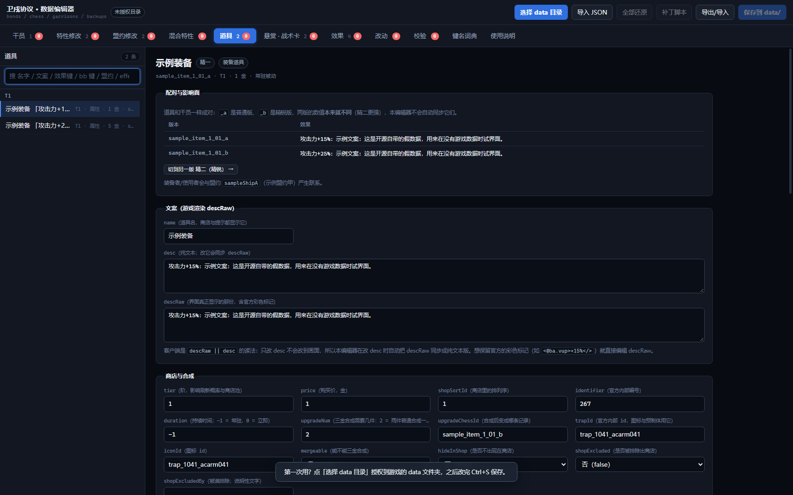

# 卫戍协议 · 数据编辑器

**Stronghold Protocol Data Editor** —— 一个单文件网页编辑器，用来改《卫戍协议：盟约》（非官方同人复刻）里的**盟约 / 特质 / 干员 / 道具 / 悬赏卡 / 战术卡 / 效果**的数值与文案，不用碰代码、不用重新构建。

> 非官方工具，与鹰角网络（Hypergryph）、Yostar 及《明日方舟》官方**没有任何关联**，也不含任何游戏数据或素材。
> 详细免责声明见 [DISCLAIMER.md](DISCLAIMER.md)，许可与版权说明见 [NOTICE.md](NOTICE.md)。

<p align="center">
  
  <br>
  <em>道具页（图里用的是仓库自带的示例假数据，不含任何游戏文本）</em>
</p>

---

## 亮点

- **单文件、零依赖**：整个编辑器就是一个 `tools/bond-editor.html`（约 400 KB），没有 npm 依赖、没有构建步骤。Chrome / Edge 里用它自带的 `File System Access API` 直接读写你的 `data/*.json`。
- **11 个页签，每个字段都能改**：干员 / 特性修改 / 盟约修改 / 混合特性 / **道具** / **悬赏·战术卡** / **效果** / 改动 / 校验 / 键名词典 / 使用说明。
- **全字段中文对照**：70 个 `buffs[].key`（备战期处理器）、76 个 `bbStr.key`（战斗内符文）、240 个 `bb` 数值键、26 个引用型字段、全部枚举——**每个键都标注了它在上游源码里的出处**（`文件:行号`），并用源码确认过「这个键到底有没有实现」。
- **保存前校验**：把「写了但不会生效」「只改了一半」「指向不存在的 id」这类坑在落盘前拦下来。
- **可重放补丁**：`data/*.json` 是构建产物，重跑 `build-data` 会覆盖你的手改。编辑器能把你这一轮的改动导出成一个补丁脚本，以后重建数据后跑一次就恢复。
- **差异包导出 / 导入**：把改动打包成 json 给别人或搬到别的机器（导入不覆盖同名记录）。

## 快速开始

### 前置

- **Chrome 或 Edge**（其他浏览器能改，但不能直接写盘，只能下载文件后手动覆盖）
- **Node.js 18+**（只有「用本地服务器打开」和「跑自测」需要；直接双击 html 也能用）
- 一份 [Stronghold-Protocol](https://github.com/sganggs/Stronghold-Protocol) 仓库（编辑器要读它的 `data/*.json`）

### 方式一：一键启动（Windows）

```powershell
powershell -ExecutionPolicy Bypass -File scripts\open-editor.ps1
```

它会在 `127.0.0.1:3001` 起一个本地静态服务，并用 Chrome / Edge 打开编辑器。

### 方式二：手动

```bash
node tools/editor-server.cjs --port 3001
# 然后浏览器打开 http://localhost:3001/
```

打开后点右上角 **「选择 data 目录」**，选你游戏仓库里的 `Stronghold-Protocol/data` 文件夹并允许读写。
（目录会被记住，下次打开点「继续用上次的目录」即可。）

### 方式三：没有游戏数据也想看看界面

仓库自带一份**假数据**（`examples/sample-data/`，文案都是「示例…」，不含任何游戏文本）：

```bash
node tools/editor-server.cjs --port 3001
# 浏览器打开 http://localhost:3001/，选择 examples/sample-data 这个目录
```

### 方式四：直接双击 html

不用服务器也能打开，但浏览器在 `file://` 下不给写盘权限，编辑器会退化成「导入 JSON → 改 → 保存时下载文件 → 自己覆盖」。

## 各页签在做什么

| 页签 | 管什么 | 要点 |
| --- | --- | --- |
| **干员** | `chess.json` / `bonds.json` / `garrisons.json` / `backups.json` | 以「一名干员一页」为中心：精一/精二并排、他牵扯到的每条盟约与特质都在同一页。 |
| **特性修改** | `garrisons.json`（249+ 条） | 按特质逐条改：`effectKey` / `eventType` / `effectType` 三个字段都是**带中文说明的下拉**；精一↔精二配对并排对照（**刻意不同，不自动同步**）。 |
| **盟约修改** | `bonds.json`（23 条） | 门槛、势力名单、全部 `bb` 数值、文案、成员反查、以现有盟约为模板合成新盟约。 |
| **混合特性** | `garrisons.json` | 把几条已有特质合成一条（按引擎的真实能力判断可行性，冲突项会告诉你哪个参数被顶掉）。 |
| **道具** | `items.json`（115 条） | 价格 / 商店 / 合成 / 盟约 + **效果实现 buffs**（逐条中文）+ **params 同步** + 与效果记录的镜像对照。 |
| **悬赏·战术卡** | `choices.json` 的 `cards.bounty` / `cards.tactic` | 卡本体（129 悬赏 + 43 战术）+ 它引用的效果（写到 `effects.json`）+ 悬赏卡「卡上字段 vs 效果黑板」两处真相对照。 |
| **效果** | `effects.json`（361 条） | 按 `effectType` 分组，每条都能看到**谁在用它**并一键跳过去。 |
| **改动** | — | 本轮所有改动的 diff、逐条撤销、导出补丁、导出/导入差异包。 |
| **校验** | — | 保存前的检查（错误 / 提醒两级）。 |
| **键名词典** | — | 所有键的中文含义 + 出处 + 「出现在哪些记录里」，可搜索、可跳转。 |
| **使用说明** | — | 界面内的完整说明（15 节）。 |

## 改完怎么生效

1. 点 **保存到 data/**（写盘前会自动把原文件备份成 `*.bak-<时间戳>.json`）。
2. **刷新游戏页面**即可看到新文案与新面板数值（客户端数据走静态服务 + 内容 ETag）。
3. **改到数值时建议重启游戏服务器**：服务端启动时读入一份数据快照（大厅校验、战斗引擎），不重启就会与客户端不一致。

改错了：点「全部还原」回到打开时的状态（还没写盘），或从 `*.bak-*.json` 恢复。

## 补丁脚本（重要）

`data/*.json` 是 `node tools/build-data.mjs` 的产物，**重建数据或更新版本会覆盖你的手改**。

改完请到「改动」页点 **生成可重放补丁脚本**，存成仓库的 `tools/patch-my-data.mjs`；以后每次重建数据后跑一次：

```bash
node tools/patch-my-data.mjs
```

补丁按三种记录布局分别写入（扁平表 / 根级布局 / 数组序位），生成时会为每个文件标好布局，不会写错位置。

## 自测

自测会用**真实数据**跑校验器与补丁生成，所以需要本地有一份游戏仓库（**只读**，绝不写入）。用 `SP_ROOT` 指定它，或把它克隆到本仓库同级目录 `../Stronghold-Protocol`：

```bash
# Linux / macOS
SP_ROOT=/path/to/Stronghold-Protocol node tools/bond-editor.test.mjs

# Windows PowerShell
$env:SP_ROOT='D:\path\to\Stronghold-Protocol'; node tools/bond-editor.test.mjs

# 或一次跑全部
npm test
```

> Windows 上如果 `npm test` 报「禁止运行脚本」（PowerShell 执行策略拦了 `npm.ps1`），
> 直接用上面那三条 `node tools/...` 即可，效果完全相同。

| 脚本 | 内容 | 规模 |
| --- | --- | --- |
| `tools/bond-editor.test.mjs` | 结构完整性、真实数据校验、错误注入、补丁生成、分享包、DOM 接线、中文词典覆盖 | 237 项 |
| `tools/bond-editor.smoke.mjs` | 端到端：改数值/文案 → 生成补丁 → 在临时沙盒里执行 → 按服务端读法验证落地（含道具、卡牌数组序位、效果） | 29 项 |
| `tools/diy-write.test.mjs` | 自选六星的写回路径（控件 → `backups.json` 真实位置） | 全部通过 |

## 数据模型要点（改之前值得先看）

完整版（带 `文件:行号` 出处）见 **[docs/DATA-MAP.md](docs/DATA-MAP.md)**，这里只列最容易踩的四条：

1. **同一份数值落成两处**：战斗侧读记录自己的 `buffs[].bb` / `bbStr`；备战侧的引擎内置效果读**扁平化的** `params`。只改一处就会出现「面板写着 +30%、实际还是 +15%」。编辑器两个页面都给出对照表与「按 buffs 重建 params」，口径与构建管线一致（**先出现者胜**）。
2. **引用是 1:1 的**：道具 ↔ `EQUIP`、悬赏卡 ↔ `ENEMY_GAIN`、战术卡 ↔ `BUFF_GAIN`、盟约 ↔ `BOND`、策略 ↔ `BAND_INITIAL`（都逐条核对过）。
3. **有些字段改了也不会生效**：`items.json` 的 `effectId`（只是构建溯源，运行时读道具自己的 buffs）、悬赏卡的 `adds[]`、`effects.json` 里 `ENEMY` 那 6 条（倍率实际在 `config.json` 的 `modes[].enemyScale`）。另外有 3 个 buff 键在上游源码里**没有处理者**：`acbattle_shop_char_cultivate_effect`、`char_dynamic_ability_new`、`other_bond_add_trigger_cnt`——词典里会标红。
4. **精一 / 精二刻意不同**：`_a` / `_b` 两版的数值与文案本来就是两套（精二更强），编辑器**不做自动同步**，只在配对对照表里标出差异。

## 中文词典是怎么来的

`buffs[].key`、`bbStr.key`、`bb` 数值键这些名字光看数据看不出含义，所以词典是**逐个键到上游服务端源码里核对**出来的：

- 找每个键的处理器/符文实现（`server/match/builtinMeta.js`、`server/match/effectsMeta.js`、`server/sim/content/**`），
- 记下**出处**（`文件:行号`）与**阶段**（备战 / 战斗 / 商店 / 回合开始 / 装备时 / 结算），
- 找不到处理者的键如实标成「源码里没有处理者：写了也不会生效」。

原料与生成器放在 [`dicts/`](dicts/README.md)：三个 JSON（词典）+ `gen-dicts.mjs`（把它们注回 `tools/bond-editor.html` 的生成区）。仓库升版、键名变了以后可以重新生成。

## 目录结构

```
stronghold-data-editor/
├─ tools/
│  ├─ bond-editor.html        # 编辑器本体（单文件，无依赖）
│  ├─ editor-server.cjs       # 本地静态服务（127.0.0.1，只为拿到写盘权限）
│  ├─ bond-editor.test.mjs    # 自测（237 项）
│  ├─ bond-editor.smoke.mjs   # 端到端冒烟（29 项，含补丁沙箱回放）
│  └─ diy-write.test.mjs      # 自选六星写回路径验证
├─ dicts/                     # 中文词典原料 + 生成器（可选，仅重建词典时用）
├─ scripts/open-editor.ps1    # Windows 一键启动
├─ docs/DATA-MAP.md           # 数据权威表：每个字段谁在读、哪些读了也没用
├─ examples/sample-data/      # 不含游戏文本的假数据，用来试界面
├─ DISCLAIMER.md              # 免责声明
└─ NOTICE.md                  # 版权与许可说明
```

## 已知限制（诚实清单）

- **只改数据，不改引擎**。`stages.json`、`enemies.json`、`waves.json`、`config.json` 等不在编辑器范围内。
- **策略 / 乐队（`bands.json`）目前只作只读参照**：效果页能看到某条 `BAND_INITIAL` 效果是谁的策略，但不能编辑它。
- **一条特质只能有一个 `effectKey`**：想让一件装备同时具备两种不同实现，做法是让干员同时带两条特质，而不是把两个键塞进一条。
- **新盟约 id 没有战斗效果**：盟约的战斗结算在上游源码里按 id 写死（核心 8 条 + `addon/` 分支），凭空新建的盟约只在面板/成员/门槛上有效。想有效果，请复制一条已有的盟约改数值。
- **精一 / 精二的差异不会被自动抹平**（这是刻意的）。
- 写盘依赖 Chrome / Edge 的 File System Access API；Firefox / Safari 只能下载后手动覆盖。
- 编辑器不联网。

## 贡献

- 欢迎 PR / issue。改 UI 或校验规则后**请先跑 `npm test`**（自测会用真实数据跑一遍，能挡住绝大多数「改了 A 崩了 B」）。
- 请不要把游戏数据（`data/*.json`）、游戏素材、或任何从游戏解包出来的内容提交进本仓库。
- 提交前请确认 `tools/` 下仍是 5 个文件、`examples/sample-data/` 里没有真实游戏文本。

## 许可与免责

- 代码与文档：**GPL-3.0-or-later**（见 [LICENSE](LICENSE)、[NOTICE.md](NOTICE.md)），与它所服务的上游项目 [Stronghold-Protocol](https://github.com/sganggs/Stronghold-Protocol) 保持一致。
- **非官方、无关联、无授权**：本工具与鹰角网络、Yostar、《明日方舟》官方无关；仓库内**不含**任何游戏数据、立绘、音频或其他素材。
- **自担风险**：改数据会直接影响你的游戏体验，请先备份 `data/`。完整条款见 [DISCLAIMER.md](DISCLAIMER.md)。

---

## English summary

A single-file, dependency-free web editor for the fan-made **Stronghold Protocol** (a non-official Arknights-themed auto-chess roguelike). It edits the project's generated JSON data — bonds, traits, operators, items, bounty/tactic cards and effects — with full Chinese glosses for every key (each annotated with its source `file:line` in the upstream repo), a pre-save validator, a replayable patch script, and export/import of change packs.

Requirements: Chrome/Edge (File System Access API) and a local clone of [Stronghold-Protocol](https://github.com/sganggs/Stronghold-Protocol). Node.js 18+ only for the local server and the self-tests.

```bash
node tools/editor-server.cjs --port 3001   # open http://localhost:3001/, pick .../Stronghold-Protocol/data
SP_ROOT=/path/to/Stronghold-Protocol npm test
```

License: GPL-3.0-or-later. **Not affiliated with Hypergryph, Yostar or Arknights; no game assets or game data are included.** See [DISCLAIMER.md](DISCLAIMER.md).
